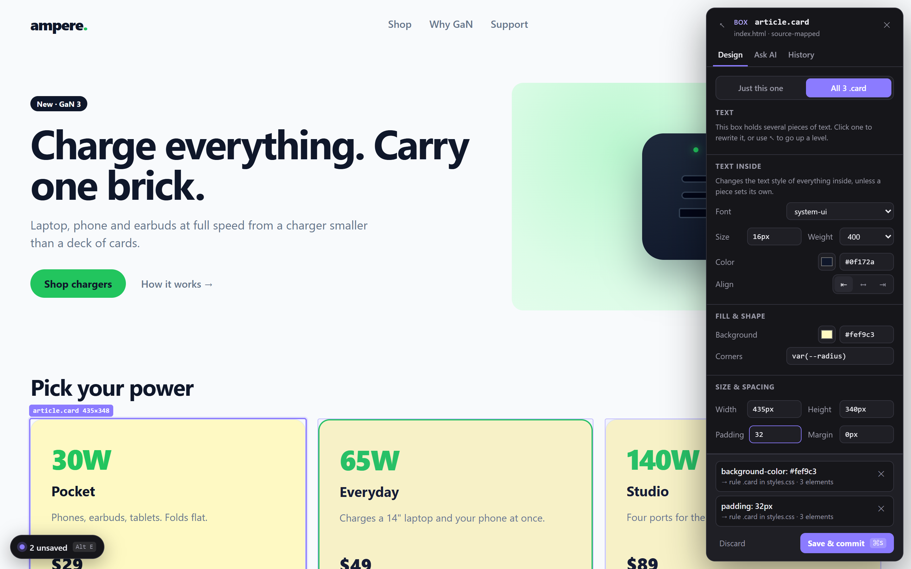
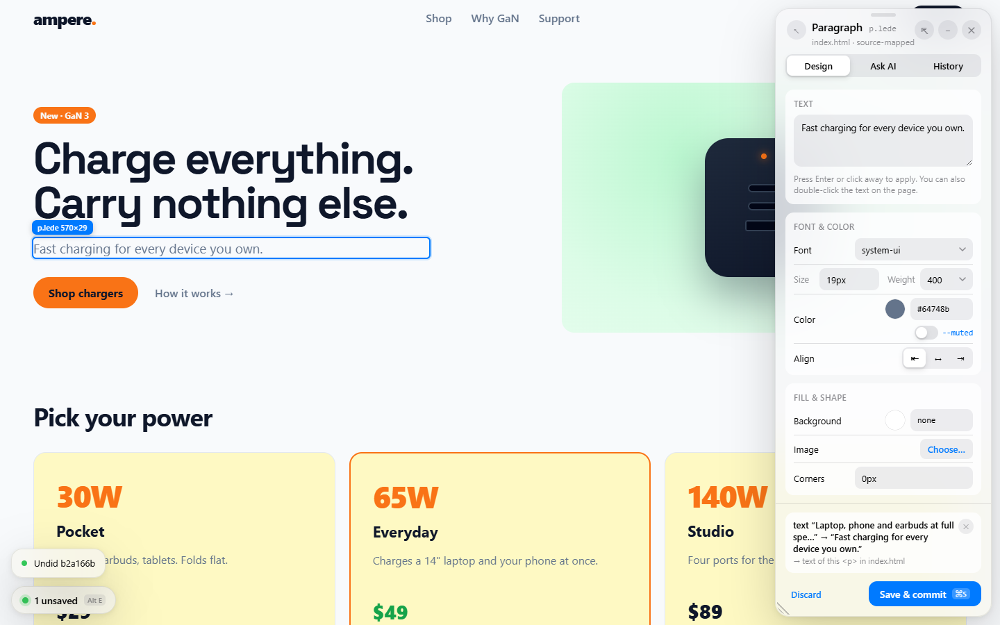
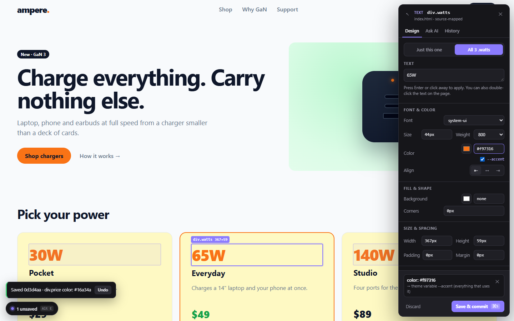
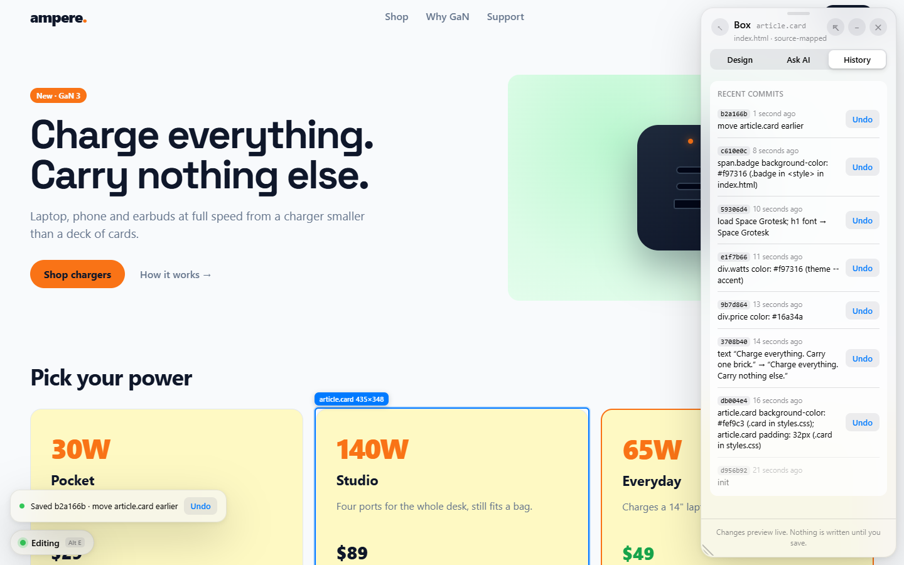
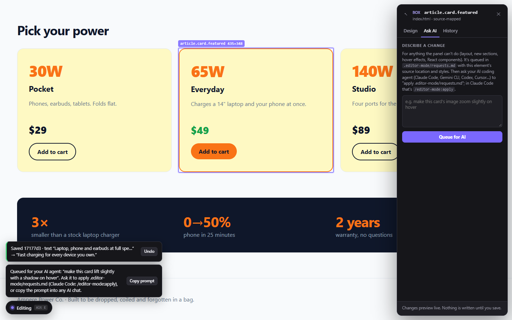

<h1 align="center">design-inside</h1>

<p align="center"><b>Click anything on your localhost site, change it visually, and design-inside writes the change into your real source files and commits it to git.</b></p>

<p align="center">
  <a href="https://github.com/musahyderr/design-inside/actions/workflows/check.yml"></a>
  <a href="#verification"></a>
  <a href="#verification"></a>
  
  
  <a href="LICENSE"></a>
</p>

> [!IMPORTANT]
> **Only for your own localhost.** design-inside runs on your computer and edits the site *you* serve from it (`localhost`, `127.0.0.1`). It can't open, wrap or change anyone else's website, it only answers your own browser, and other websites you visit can't use it.

Built for the moment after an AI generates your site and *one thing* is off: a card color, a heading font, some text. Fix it yourself in seconds, with no prompt and no tokens. For anything bigger, it hands a precise request to your AI coding agent: Claude Code, Gemini CLI, Codex, Cursor or any other.



## Quick start

You need [Node.js](https://nodejs.org) 22+ and git, on Linux, macOS or Windows.

```bash
git clone https://github.com/musahyderr/design-inside.git
```

```bash
node design-inside/dist/design-inside.mjs ./my-site
```

Open **http://localhost:4400**, press **Alt+E** (or click **Edit page**), and click anything. Already running a dev server on, say, port 5173? Wrap it instead, and its hot reload keeps working:

```bash
node design-inside/dist/design-inside.mjs --proxy 5173 ./my-site
```

The tool is a single bundled file, so there's nothing to `npm install`. Using Claude Code? Install it as a plugin instead: see [With Claude Code](#with-claude-code).

## The panel

The panel shows only the controls that fit what you clicked. A heading gets text and font controls, an image gets size with *Keep proportions*, and a card gets background, spacing and "Text inside".

Put the panel wherever it suits you. Use **⇱** to dock it **left, top, center or right**, drag its top bar to place it anywhere, drag its corner to resize it, or use **–** to collapse it to its title bar. The layout is remembered for each site, and **Reset** restores the default.

| | |
|---|---|
|  |  |
| **Text box.** Type new text in the panel, or double-click it on the page. | **Theme colors.** Change a color everywhere through its `--variable`, or only here. |
|  |  |
| **History.** Every save is a git commit with one-click **Undo**. | **Ask AI.** Anything the panel can't do goes to your AI agent, with the exact source location. |

## What it does

| You do | It writes |
|---|---|
| Type in the Text box, or double-click text | The text of that element in your source file |
| Change a color, font, size, padding or corners for **all similar** elements | The rule that actually wins the cascade, in its own file, e.g. `.card { … }` in `styles.css`, including rules in `@media` blocks and `<style>` tags |
| Change it for **just this one** | An inline `style=""` on that element only, or the rule if only that element uses it |
| Change a color that comes from `var(--accent)` | Your choice: the theme variable in `:root` (changes everywhere) or only this element |
| Pick a font from the curated list | The Google Fonts `<link>`, added once, plus `font-family` with fallbacks |
| Resize an image | Width or height, with the other side set to `auto` to keep its proportions |
| Move an item earlier or later | The two elements, swapped in the HTML source |
| Edit a Tailwind element | Swapped utilities: `text-slate-900 text-2xl` → `text-[#ea580c] text-[32px]` |
| Ask for anything else ("zoom the image on hover") | A request in `.design-inside/requests.md` with the element's file, selector and styles, for your AI agent |

Every save is **one git commit** that touches only the files it changed. **Undo** is a `git revert`, from the toast or the History tab, and it never rewrites history.

## Use it with your AI agent

The panel works without any AI. The **Ask AI** tab is for changes it can't make safely, such as layout, new sections, hover effects or React components. Your request is saved to `.design-inside/requests.md` together with the element's source location and current styles, and the top of that file tells the agent exactly what to do.

### With Claude Code

```bash
/plugin marketplace add musahyderr/design-inside
```

```bash
/plugin install design-inside@design-inside
```

Then, in your project:

- `/design-inside:start` finds your running dev server or HTML folder and starts the editor.
- `/design-inside:apply` applies what you queued, one commit per request, so each one can be undone from the editor.

### With Gemini CLI, Codex, Cursor, Copilot or any other agent

Start the editor as in [Quick start](#quick-start), queue requests in the **Ask AI** tab, then tell your agent:

> apply .design-inside/requests.md

No coding agent? Click **Copy prompt** on the toast and paste it into any AI chat.

## Safety (these rules are the design)

- **Your localhost only.** The server listens on 127.0.0.1 and refuses any other `Host`, which blocks DNS rebinding. It refuses writes that come from another website or aren't JSON, so a page you visit can't edit your files or queue instructions for your AI. `--proxy` only wraps a dev server on your own computer.
- **Previews are live, writes are explicit.** Nothing touches disk until you press **Save**, and the pending list shows the exact destination of every change before you do.
- **It refuses rather than guesses.** If the file no longer matches the page, or a search finds the text in two places, it stops and offers to hand the change to your AI agent.
- **It never commits over your work.** If a file it needs has uncommitted changes, it won't touch that file.
- **Minimal diffs.** HTML edits are byte-range splices and CSS goes through postcss, so changing one color is a one-line diff. Windows (CRLF) line endings are kept.
- **Only inside the project folder.** It never touches `.git`, `node_modules` or dotfiles such as `.env`, which are never served either. Edited values are checked so they can't break out of the CSS or HTML they go into.

## Verification

[](https://github.com/musahyderr/design-inside/actions/workflows/check.yml)

Every pull request and every change to `main` runs the full test suite in CI. A branch ruleset blocks any change to `main` that doesn't pass on all four platforms below. You can re-run every check yourself with `npm run check`, and the results of every run are public in [Actions](https://github.com/musahyderr/design-inside/actions/workflows/check.yml).

| Platform | Node.js | Required to merge |
|---|---|---|
| Ubuntu (Linux) | 22 | ✅ |
| macOS | 22 | ✅ |
| Windows | 22 | ✅ |
| Ubuntu (Linux) | 24 | ✅ |

**What runs on each platform**

| Suite | Checks | What it proves |
|---|---|---|
| Unit tests | 35 | Source editing (HTML, CSS, `<style>` blocks, Tailwind), Windows line endings are kept, framework text search, git history and undo, and the security rules |
| Browser: static site | 51 | The real panel in Chromium: moving, docking, resizing and collapsing the panel (and saving while it is moved), live preview, cascade-aware rule edits, inline edits, theme variables, fonts, Text box, reordering, undo, Ask AI queue, live reload, refusing to commit over your work, element-aware controls, outline position while scrolling |
| Browser: proxy mode | 9 | Wrapping a dev server: source-mapped HTML, JavaScript-rendered text, CSS rules, and hot-reload WebSocket passthrough |
| Browser: Tailwind | 5 | Panel changes become utility-class swaps, and unrelated classes are kept |
| Dependency audit | `npm audit` | No known vulnerabilities in runtime dependencies |
| Build check | `git diff dist/` | The shipped `dist/` bundle is exactly what the source builds to |

**Security tests** (`test/security.test.js`) confirm that the server:

- refuses requests from other websites, and non-JSON writes;
- refuses any `Host` that isn't localhost, which blocks DNS rebinding;
- never serves `.env` or other dotfiles;
- refuses `--proxy` targets that aren't on your own computer;
- rejects edit values that try to break out of CSS or HTML.

Four of these tests failed before the security fix, which shows they catch real problems.

## How it works

```
browser ── localhost:4400 ── design-inside ── (your files | your dev server on localhost)
   │                             │
   overlay (shadow DOM)          ├─ tags each served element with data-em="file#element-path"
   ├─ reads the live CSSOM       ├─ applies a batch of changes in memory; writes only if all succeed
   │  to find the winning rule   ├─ git commit / git revert
   └─ POST /__em/apply ─────────▶└─ watches files; reloads the page when your AI edits them
```

- **Element paths, not line numbers.** Elements are identified by their position in the source parse tree, so the page stays mapped after every save.
- **The browser decides which rule wins.** The overlay ranks matching rules by `!important`, specificity and order, and the server finds the same rule with postcss.
- **Framework pages** (React, Vue…) have no source map. There, text and Tailwind class edits find the one place in your source with that exact string. If there isn't exactly one, the change goes to your AI agent.

More detail: [docs/ARCHITECTURE.md](docs/ARCHITECTURE.md).

## Limits (v0.1)

- One-off styling of **framework components** without Tailwind goes to your AI agent; there are no per-framework source plugins yet.
- CSS nesting, `@scope` and CSS-in-JS (styled-components, hashed CSS-module names) aren't edited directly.
- Text with markup inside it (`Hello <b>world</b>`) is edited part by part, or by your AI agent.
- Position means **order**, not free drag-and-drop, because free positioning breaks responsive layouts.
- Proxy mode is tested against a stand-in dev server. Real Vite, Next and Astro projects should work the same way, but they aren't in the automated tests yet.

## Similar tools

Others work on the same idea in different ways:

- [Onlook](https://github.com/onlook-dev/onlook) is a full open-source visual design app for React, Next.js and Tailwind projects.
- [Replit's Visual Editor](https://docs.replit.com/replitai/visual-editor) writes simple edits straight to code, inside Replit's cloud.
- [Layrr](https://github.com/narnia-sh/layrr), [PulseDev](https://www.producthunt.com/posts/pulsedev) and [Fronti](https://chromewebstore.google.com/detail/visual-editor-ai/jojjbmgmggenijlkhjeaiodfoggjcjgj) send every click-and-describe change to an AI agent.
- [Chrome DevTools Workspaces](https://developer.chrome.com/docs/devtools/workspaces) can save CSS edits to local files.

design-inside aims to be small and safe: it works on any local site, makes simple edits with no AI, turns every save into an undoable git commit, works with any AI agent or none, and only ever touches your own localhost.

## Contributing

Issues and pull requests are welcome. Run the full check before opening a PR:

```bash
npm install
```

```bash
npx playwright install chromium
```

```bash
npm run check
```

It runs the unit tests, rebuilds `dist/`, and then runs three browser suites, each against a scratch git copy: the static site in `examples/charger-site`, proxy mode against a stand-in dev server, and a Tailwind site. To use your installed Chrome instead of downloading Chromium, run `EM_BROWSER=chrome npm run check`. CI runs the same check on Linux, macOS and Windows for every pull request.

`dist/` is committed so the tool runs without an install, so run `npm run build` after changing `src/` or `client/`.

Found a security problem? Please report it privately through [Security → Report a vulnerability](https://github.com/musahyderr/design-inside/security/advisories/new) rather than in a public issue.

## License

[MIT](LICENSE)
