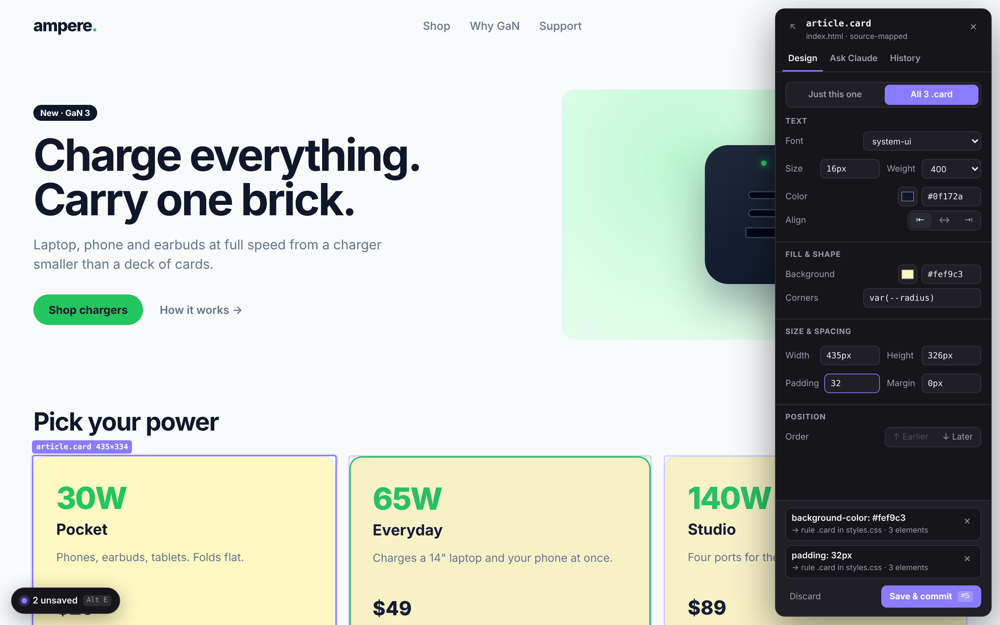

# editor-mode

**Click anything on your localhost site, change it visually, and editor-mode writes the change into your real source files and commits it to git.** Anything it can't do safely goes to Claude.

Built for the moment after an AI generates your site and *one thing* is off: a card color, a heading font, some text.



## What it does

| You do | It writes |
|---|---|
| Double-click text, or type in the panel's Text box | The text inside that element in your `.html` file |
| Change a color, size, padding or corner radius for **all similar** elements | The rule that actually wins the cascade, in its own file, e.g. `.card { … }` in `styles.css`, including rules in `@media` blocks and in `<style>` tags |
| Change it for **just this one** | An inline `style=""` on that element only. If a rule is used by that element alone, it edits that rule instead |
| Change a color that comes from `var(--accent)` | You choose: the theme variable in `:root` (changes everywhere) or only this element |
| Pick a font from the curated list | Adds the Google Fonts `<link>` once and writes `font-family` with fallbacks |
| Move an item earlier or later | Swaps the two elements in the HTML source |
| Edit a Tailwind element | Swaps the conflicting utilities: `text-slate-900 text-2xl` → `text-[#ea580c] text-[32px]` |
| Ask for anything else ("zoom the image on hover") | Queues it with the element's source location and styles for `/editor-mode:apply` |

Every save is **one git commit** that touches only the files it changed. **Undo** is a `git revert` (it never rewrites history), from the toast or the History tab.

## Safety rules (these are the design)

- **Previews are live, writes are explicit.** Nothing touches disk until you press Save. The pending list tells you the exact destination of every change *before* you save.
- **It refuses rather than guesses.** If the text or class list in the file no longer matches the page, or a search finds the text in two places, it stops and offers to hand the change to Claude.
- **It never commits over your work.** If a file it needs has uncommitted changes, it won't touch that file.
- **Minimal diffs.** HTML edits are byte-range splices at parser source offsets, and CSS goes through postcss, so formatting outside the changed value is preserved. Changing one color is a one-line diff.
- **Only inside the project folder**, never `.git` or `node_modules`.

## Install (Claude Code plugin)

```bash
/plugin marketplace add musahyderr/editor-mode
```

```bash
/plugin install editor-mode@editor-mode
```

Then in any project:

- `/editor-mode:start` detects a running dev server or a plain HTML folder and starts the editor.
- `/editor-mode:apply` makes Claude apply what you queued in the **Ask Claude** tab, one commit per request, so each one is undoable from the editor.

The plugin ships a single bundled file (`dist/editor-mode.mjs`, Node 18+), so there's nothing to `npm install`.

### Or run it directly

```bash
node dist/editor-mode.mjs ./my-site
```

```bash
node dist/editor-mode.mjs --proxy 5173 .
```

The first serves a plain HTML/CSS folder. The second wraps a running dev server (Vite, Next, Astro…) and keeps its hot reload working through a websocket passthrough. Open `http://localhost:4400`, press **Alt+E**, and click.

## How it works

```
browser ── localhost:4400 ── editor-mode ── (static files | your dev server)
   │                             │
   overlay (shadow DOM)          ├─ tags each served element with data-em="file#element-path"
   ├─ reads the live CSSOM       ├─ applies a batch of changes in memory; writes only if all succeed
   │  to find the winning rule   ├─ git commit / git revert
   └─ POST /__em/apply ─────────▶└─ watches files; reloads the page when Claude edits them
```

- **Element paths, not line numbers.** Elements are identified by their position in the *source* parse tree (`0.1.2.1.2`). Text, attribute and style edits don't change paths, so the page stays mapped after every save.
- **The browser decides which rule wins.** The overlay walks `document.styleSheets`, keeps rules whose media queries match and whose selectors match the element (ignoring `:hover`), and ranks them by `!important`, specificity and order. The server finds the same rule with postcss using a shared selector normalizer.
- **Framework pages** (React, Vue…) have no source map. There, text and Tailwind class edits work by finding the one place in your source that contains that exact string. If it isn't exactly one place, the change goes to Claude.

## Current limits (v0.1)

- One-off and per-rule styling of **framework components** without Tailwind goes through Claude (no per-framework source plugins yet).
- CSS nesting, `@scope`, and CSS-in-JS (styled-components, CSS modules' hashed names) aren't edited directly.
- Text with inline markup inside it (`Hello <b>world</b>`) is edited part by part, or via Claude.
- Position means **order**, not free drag-and-drop; free positioning breaks responsive layouts.

## Development

```bash
npm install
```

```bash
npx playwright install chromium
```

```bash
npm run check
```

`npm run check` runs the unit tests, rebuilds `dist/`, then drives the real overlay in Chromium against a scratch git copy of `examples/charger-site`: live preview, rule editing, inline edits, theme variables, fonts, `<style>` blocks, reordering, undo, the Claude queue, live reload and the uncommitted-work guard. To use an installed Chrome instead of downloading Chromium, run `EM_BROWSER=chrome npm run check`.

`dist/` is committed so the plugin runs without an install: run `npm run build` after changing `src/` or `client/`. How it works inside: [docs/ARCHITECTURE.md](docs/ARCHITECTURE.md).

## License

MIT
